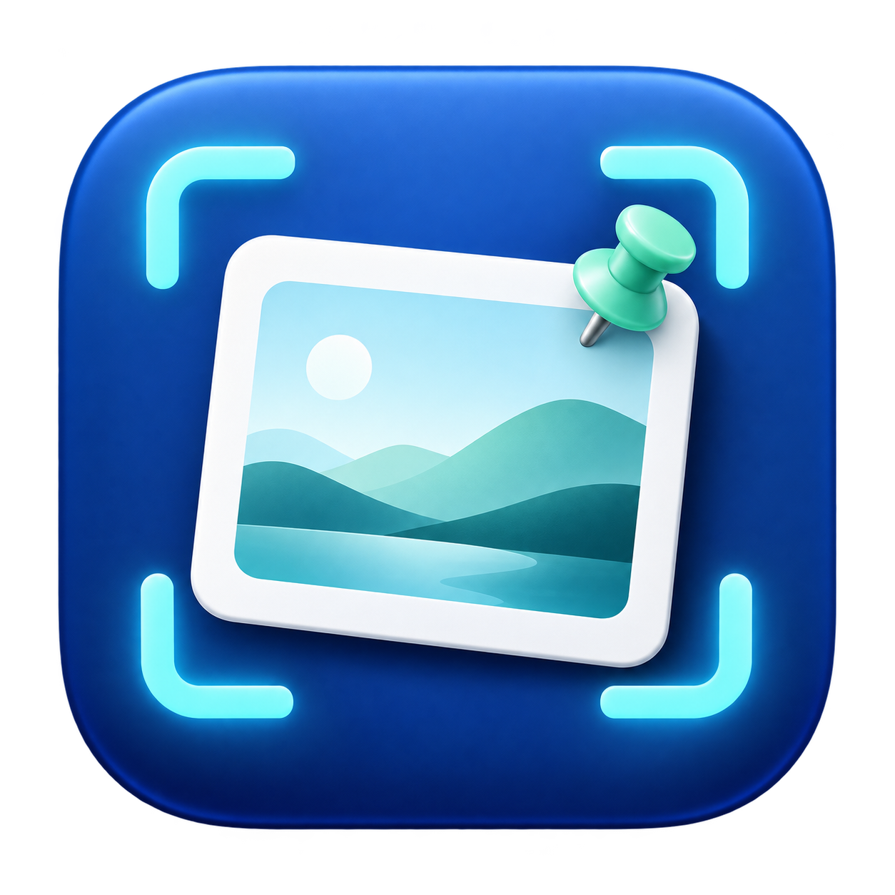

# 映贴



**快捷截图、图片标注与桌面贴图，让信息随手截、随手用。**

映贴（原名 Snipaste-RS）是一个以 Snipaste 的界面和操作流程为参考的开源截图工具，使用 Rust 构建原生桌面界面。你可以通过快捷键截取窗口或任意区域，添加标注、遮挡敏感内容，再复制到聊天、文档或笔记中；也可以把图片固定在桌面上，方便边看边工作。

适合日常沟通截图、问题反馈、设计取色，以及将参考资料贴在屏幕上对照使用。

[快速开始](#快速开始) · [功能](#功能) · [快捷键](#快捷键) · [开发与文档](#开发与文档)

## 为什么选择映贴

- **操作连贯**：悬停预选窗口、拖动框选、就地标注、确认复制，截图后可以直接粘贴到支持图片的应用。
- **轻量待机**：启动时只建立托盘和热键；窗口、字体和图形设备按需加载，截图结束后释放会话资源。没有贴图时，空闲 3 秒后释放图形设备。
- **原生界面**：采用 Rust、winit、egui 和 wgpu，不依赖 Electron 或 WebView。Windows 使用 DX12，初始化失败时尝试 Vulkan；Mac 使用 Metal。
- **截图之外也实用**：支持 HEX / RGB 取色、选区二维码识别和桌面贴图，减少在多个工具之间切换。
- **本机处理**：截图、标注、取色和二维码识别均在本机完成；二维码结果以文字显示，不自动打开链接。

### 内存实测

Windows 0.2.3 在一台 3440 × 1440 显示器的测试电脑上：

| 阶段 | 工作集 |
|---|---:|
| 启动待机 | 12.9 MiB |
| 连续三轮截图结束后待机 | 27.8 MiB |

以上是单机测量结果，内存占用会随屏幕尺寸、驱动和贴图数量变化。释放图形设备后的下一次截图需要重新初始化，本次测量约为 323–418 ms。完整环境、原始数据和取舍见 [内存优化记录](docs/memory.md)。

## 功能

| 功能 | 说明 |
|---|---|
| 窗口与区域截图 | 悬停预选窗口，单击确定；拖动自由框选，支持调整大小、移动选区和像素级微调 |
| 图片标注 | 矩形、椭圆、箭头、画笔、记号笔与中文文字，可调整颜色和工具属性 |
| 马赛克与橡皮擦 | 像素马赛克、模糊打码；支持框选或涂抹。橡皮擦局部恢复底图，保留区域外标注 |
| 撤销与重做 | 撤销、重做、删除选中标注和清空标注 |
| 确认与复制 | 点击勾号、按 Enter 或使用复制快捷键，合成选区图片并写入系统剪贴板 |
| 保存图片 | 系统保存对话框，支持 PNG / JPEG；取消保存可回到截图 |
| 像素取色 | 放大镜显示坐标和颜色，支持 HEX / RGB 切换与复制 |
| 二维码识别 | 点击二维码按钮或按 Q，识别当前选区内的二维码，支持多个结果和复制内容 |
| 桌面贴图 | 将选区或剪贴板图片贴到桌面，支持拖动、缩放、透明度调整、复制、保存和关闭 |
| 后台常驻 | Windows 托盘 / Mac 菜单栏、全局热键、热键占用时尝试候选键、可选开机自启 |

标注导出包含图片与标注，选区边框、工具条等界面元素不会进入最终图片。

## 平台与版本

当前源码版本：**0.2.4**。现有 Windows 发布包版本：**0.2.3**。

| 平台 | 当前状态 |
|---|---|
| Windows x64 | 已完成截图主流程和桌面贴图，单元测试与原生验收通过 |
| macOS 14+ / Apple Silicon | 已在 Apple M3 / macOS 15.5 完成原生构建、150 项单元测试、截图 / 标注 / 剪贴板 / 二维码 / 贴图自动验收；其他系统与显示配置仍需验证 |
| Intel Mac / Linux | 当前不提供支持 |

Mac 每次截图覆盖**发起截图时鼠标所在的显示器**，暂不支持一次跨多个显示器框选。Windows 混合 DPI 多屏仍需更多真机验证。

## 快速开始

### Windows：下载后运行

1. 在本仓库的 **Releases** 页面查找 Windows 发布包：`snipaste-rs-0.2.3-win64.zip`，或独立程序 `snipaste-rs-0.2.3.exe`。
2. 解压后运行 `snipaste-rs.exe`；独立程序可以直接运行，无需安装 Rust。
3. 程序启动后驻留系统托盘。按 **F1** 开始截图，或从托盘菜单选择“截图”。

如果 Releases 尚无附件，可以使用下方的源码构建方式。运行新版前，请先从托盘退出旧版。

**完成第一张截图：**

按 F1 → 拖动选择区域 → 按 Enter 确认 → 在聊天、文档或笔记中按 **Ctrl+V** 粘贴。

如 F1 已被其他软件占用，程序会尝试候选热键；菜单和截图界面显示实际生效的键。

### macOS：Apple Silicon 本机构建

要求 **macOS 14 或更新版本**，以及 Apple Silicon 芯片。

1. 安装当前稳定版 [Rust](https://rustup.rs)，并安装 Apple 命令行开发工具：

   ```bash
   xcode-select --install
   ```

2. 在 GitHub 点击 **Code → Download ZIP** 获取源码并解压，或使用 Releases 中的 `yingtie-0.2.4-macos-arm64-source.zip`（如已上传）。
3. 双击项目根目录的 **Build macOS.command**。也可以在项目目录运行：

   ```bash
   bash scripts/build-macos.sh
   ```

4. 将生成的 `dist/macos-0.2.4/映贴.app` 移入“应用程序”，然后打开。顶部菜单栏仅显示截图图标，点击可打开截图、贴图、权限设置、自启、操作说明、关于和退出菜单。
5. 按 **⌘⇧2** 或从菜单栏选择“截图”。权限提示中点击 **打开权限设置** 可直接跳转，在 **系统设置 → 隐私与安全性 → 屏幕录制 / 屏幕与系统音频录制** 中授权，再退出并重新打开应用。

构建需要 macOS 14+ SDK，首次编译会下载依赖。脚本同时生成 `dist/yingtie-0.2.4-macos-arm64.zip`，本机构建默认使用固定的本机签名证书；本机构建与验收已通过，Developer ID 签名和 Apple 公证尚未执行。更多权限、签名和验收步骤见 [Mac 指南](docs/macos.md)。

需要同时检查代码和运行单元测试时，使用 `bash scripts/build-macos.sh --verify`。桌面功能验收和三轮内存诊断分别使用 `bash scripts/verify-macos.sh`、`bash scripts/verify-macos.sh --memory`，验收应用需要自己的屏幕录制权限。

### Windows：从源码构建

安装当前稳定版 [Rust](https://rustup.rs) 和 **Visual Studio Build Tools**，勾选“使用 C++ 的桌面开发”。在开发者 PowerShell 中进入解压后的项目目录：

```powershell
rustup target add x86_64-pc-windows-msvc
cargo build --locked --release -p snipaste-app --target x86_64-pc-windows-msvc
.\target\x86_64-pc-windows-msvc\release\snipaste-rs.exe
```

现有 Windows 验收使用 GNU 工具链；使用 MinGW-w64 / w64devkit 的配置步骤见 [构建指南](docs/build.md)。

## 快捷键

| 操作 | Windows | macOS |
|---|---|---|
| 开始 / 收起截图 | F1 | ⌘⇧2，F1 可用时也注册 |
| 桌面贴图 | F3 | ⌘⇧1，F3 可用时也注册 |
| 确认并复制截图 | Enter / Ctrl+C / 勾号 | Enter / ⌘C / 勾号 |
| 在其他应用中粘贴 | Ctrl+V | ⌘V |
| 保存截图 | Ctrl+S | ⌘S |
| 撤销 | Ctrl+Z | ⌘Z |
| 重做 | Ctrl+Y / Ctrl+Shift+Z | ⌘Y / ⌘⇧Z |
| 识别选区二维码 | Q | Q |
| 切换 HEX / RGB | 放大镜显示时按 Shift | 放大镜显示时按 Shift |
| 复制当前像素颜色 | 放大镜显示时按 C | 放大镜显示时按 C |
| 框选后临时取色 | 按住 Alt | 按住 Option |
| 取消截图 | Esc | Esc |

文字输入期间，Enter 用于提交文字，Shift+Enter 换行；Esc 会先关闭二维码结果、放弃文字输入或当前拖动，再取消截图。Mac 的 F1 / F3 可能需要配合 Fn 使用。

**贴图操作：**拖动移动；滚轮缩放；Shift+滚轮调整透明度；右键打开更多操作；Esc 或双击关闭。

## 当前边界

- 暂未提供滚动截图、OCR、贴图分组与历史库，以及完整的高级设置。
- Windows 使用 GDI 捕获，独占全屏游戏和受保护视频内容不保证能正常截取。
- macOS 已通过当前 Retina 显示器上的自动截图与 Metal 验收，以及旧授权刷新后的独立启动截图回归；首次拒绝权限的完整交互、外接屏切换、全屏 Space、焦点恢复、系统保存面板和登录后自启仍需专项交互验收。已完成 Mac debug 诊断和 5K 屏 release 内存对比，见 [Mac 内存记录](docs/macos-memory.md)，不能套用 Windows 测量结果。

## 开发与文档

项目按职责拆分为五个 crate：

| 模块 | 职责 |
|---|---|
| `snipaste-core` | 几何、标注、样式与历史等纯逻辑 |
| `snipaste-render` | 界面主题、字体、标注绘制与图像效果 |
| `snipaste-capture` | 冻结桌面像素与选区裁剪 |
| `snipaste-platform` | 热键、剪贴板、窗口查询、保存、权限和自启 |
| `snipaste-app` | 事件循环、截图界面和贴图窗口 |

此前 Windows 验收通过 **142 项单元测试**，本次 macOS 验收通过 **150 项单元测试**，另有 1 项生成验收图片的任务默认忽略。Mac 可运行以下命令，执行原生桥编译、代码检查、单元测试和打包：

```bash
bash scripts/build-macos.sh --verify
```

桌面交互验收需要屏幕录制权限，使用 `bash scripts/verify-macos.sh`。结果与当前验证范围见 [Mac 验证记录](docs/macos-verification.md)。

- [构建指南](docs/build.md)
- [Mac 使用与验收](docs/macos.md)
- [截图交互与实现边界](docs/snipaste-alignment.md)
- [内存优化与测量](docs/memory.md)
- [Apple Silicon CI 工作流](.github/workflows/macos-arm64.yml)
